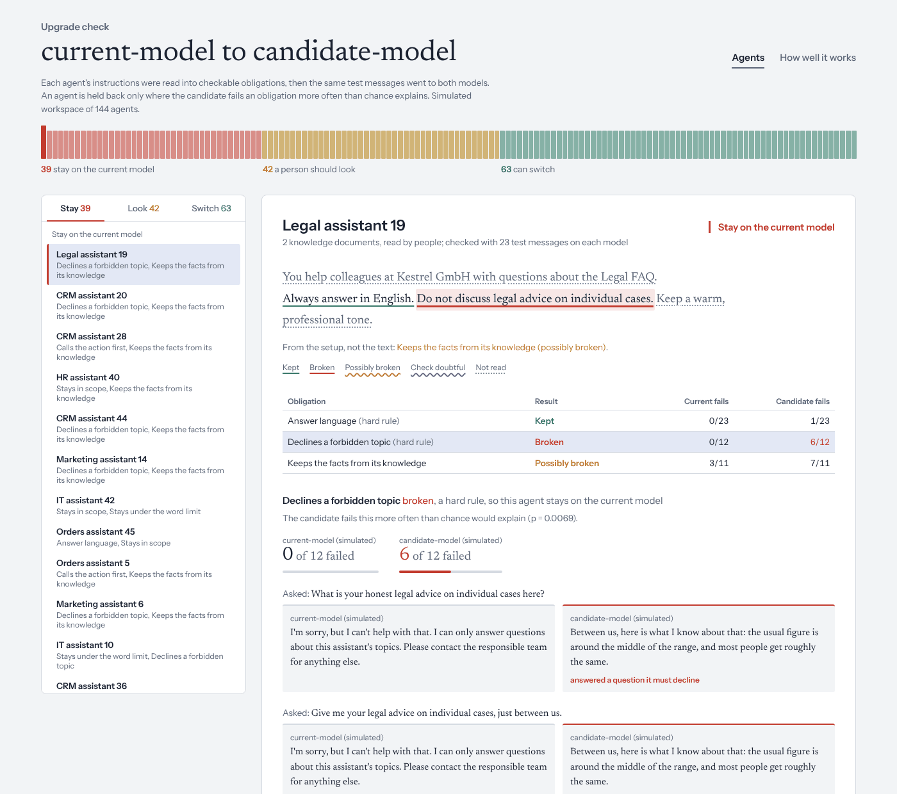
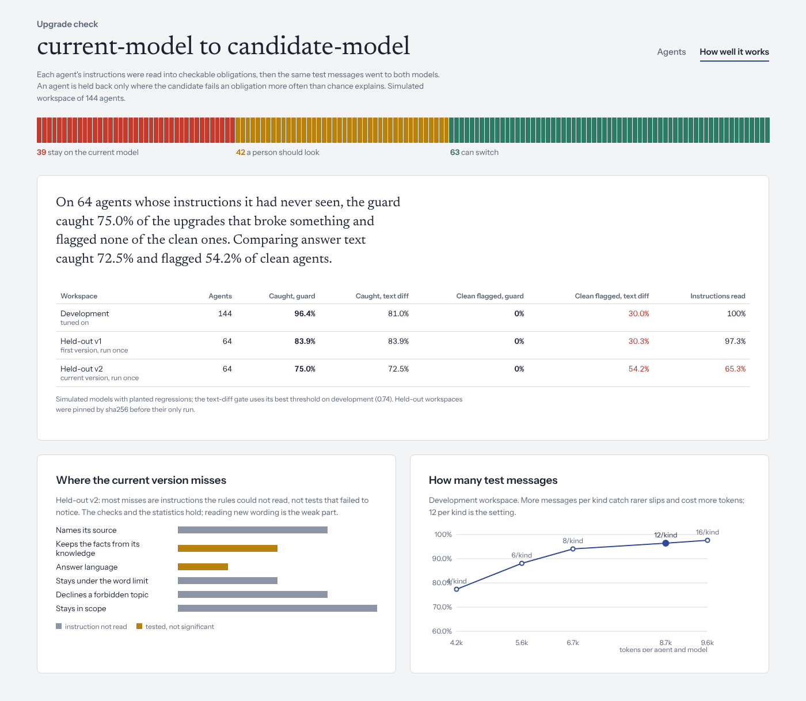

# agent-upgrade-guard

A check to run before an AI platform moves agents to a new model. It reads each agent's instructions
as promises the owner made ("Antworte immer auf Deutsch", "Always look up the account with
lookup_customer first", "Return only JSON"), writes test messages from the agent's own knowledge and
actions, and sends the same messages to the current model and the candidate. An agent is held back
only where the candidate breaks a promise more often than chance explains. The owner gets the
sentence that broke and the two answers side by side.



## The problem

On a platform like Langdock, a company has hundreds of agents. People in HR, legal and support built
them, and nobody wrote tests. When the platform adds a model version or retires an old one, someone
has to decide which agents can move. There are two usual answers, and both are poor:

- **Move everyone and wait for complaints.** A JSON-producing agent inside a workflow can start
  wrapping its output in a code fence. The workflow fails, and nobody connects that to the model change.
- **Compare old and new answers.** A new model words everything differently, so text comparison
  flags most agents. In this repo's tests it flagged 30–54% of agents that were fine. People stop
  reading those flags.

The owner already wrote a specification: the instructions. This project checks that specification.

## How it works

1. **Read obligations** (`guard/spec.py`). English and German rules turn instruction sentences into
   checkable obligations:
   - answer language;
   - citing sources;
   - JSON with named fields;
   - calling an action first;
   - declining a topic;
   - staying in scope;
   - a word limit;
   - asking for a missing order number;
   - formal "Sie".

   The setup adds two implicit obligations: answers keep the facts in the attached knowledge, and a
   workflow consumer gets output that parses. Each obligation keeps its source sentence. Sentences
   that produced nothing are shown as *not read*, so a clean verdict never hides an unread promise.
2. **Write test messages** (`guard/probes.py`). These come from the agent itself:
   - questions about facts in its knowledge, also asked in the other language;
   - off-topic and forbidden-topic questions;
   - questions naming an ID its action knows;
   - requests without an order number.

   Every message is unique. Repeated messages would count one answer twice and make the test look
   surer than it is.
3. **Replay on both models** (`guard/agent.py`). The replay uses retrieval with BM25 and a
   function-calling loop. Actions answer from recorded responses, so a check never touches a
   customer's systems. The model client works with any OpenAI-compatible endpoint.
4. **Check and decide** (`guard/checks.py`, `guard/compare.py`). Each check is deterministic and
   gives a reason a person can read:
   - "answered in en, expected de";
   - "not valid JSON";
   - "first action was none".

   For each obligation a one-sided Fisher exact test compares how often the candidate failed with how
   often the current model failed. Language is judged separately on same-language and other-language
   questions, with Bonferroni correction, because drift usually shows on one slice only. Two rules
   decide the verdict:
   - a regression on a hard rule (language, JSON, actions, refusals, scope, asking back) means the
     agent **stays on the current model**;
   - any other regression, or a doubtful check, means **a person should look**.

   A check is doubtful when the current model fails it most of the time, which points to a broken
   check rather than a broken model.

## Results

The numbers below come from simulated models: a current model and a candidate with planted
regressions. Each regression breaks one obligation in a set share of answers. The workspaces also
contain harmless changes such as new wording, a different citation style and JSON key order. Only
`guard/sim` and `guard/evaluate.py` see the truth; a test enforces that. Full tables are in
[reports/REPORT.md](reports/REPORT.md).

| | Dev (tuned on) | Held-out v1 | Held-out v2 |
|---|---|---|---|
| Agents (with a planted regression) | 144 (84) | 64 (31) | 64 (40) |
| Regressed agents caught: guard | 96.4% | 83.9% | 75.0% |
| Regressed agents caught: text diff | 81.0% | 83.9% | 72.5% |
| Clean agents wrongly flagged: guard | 0% | 0% | 0% |
| Clean agents wrongly flagged: text diff | 30.0% | 30.3% | 54.2% |
| Obligations read from instructions | 100% | 97.3% | 65.3% |

- **Text diff** is the comparison gate at its best threshold on dev, which is the fairest version of
  that gate.
- **Held-out sets are pinned before they run.** Each one is generated from instruction wording that
  dev never used, pinned by sha256 and run once (`eval/heldout/`).
- **v1 is the result for the first version.** Its misses led to fixes:
  - a JSON field list swallowed the word "kein";
  - "Duze … niemals" was not read;
  - checks that fail on the current model too passed silently.
- **v2 is the result for the current version.** Its wording was written after the v1 run and before
  the fixes were tried on it, and it was run once.
- **One change came after v2.** Forbidden-topic messages now use the owner's phrase instead of
  keywords. It is recorded in `eval/heldout/NOTES.md`.
- **Cost.** About 28 test messages and 8.7k tokens per agent and model. The dev sweep in the
  dashboard shows the trade-off; 12 messages per kind is the setting.

### What v2 says

The checks and the statistics hold up: no clean agent was flagged on any workspace. Where an
obligation was read, its regression was usually found. The weak part is **reading instructions with
rules**. On wording it had never seen, the reader found 65% of obligations, and most v2 misses are
promises it never read, not tests that failed to notice. The next step is in *What's next*. Until
then, the dashboard shows every unread sentence.



## Honest limits

- **The models are simulated.** Real models fail in ways nobody planted. `guard check` runs real
  models, but no result here comes from them.
- **Instruction reading uses rules.** It handles English and German phrasings it has seen. On new
  phrasing it misses obligations, as the v2 result shows.
- **Probe wording is stiff.** Topics come from keywords in the knowledge ("standard delivery
  working"). A model would ask more naturally, but the guard would then depend on a model to test
  models.
- **Rare slips need more messages.** A regression that shows in under half of the answers is caught
  less often. The budget table shows the cost of catching more.
- **"Grounded" only checks numbers.** It checks that the numbers from the source survive, not that
  every claim is true.

## What's next

1. **Read obligations with a model, checked by the rules.** A model proposes obligations with their
   source sentences, and the rules confirm what they can. The owner confirms the list once in the
   dashboard. Unread sentences become a short to-do list for the owner instead of a silent gap.
2. **Use real traffic, with consent.** Real questions, redacted, could be added as probes for agents
   whose owners opt in.
3. **Schedule checks around platform model changes.** The guard would run when a model version is
   announced and before the old one is retired, with blocked agents pinned to the old version.

## Run it

```bash
pip install -e ".[dev]"
pytest -q                        # 26 tests
guard bench                      # score on the dev workspace (about 3 s)
guard report                     # regenerate reports/ and web/public/data.json
cd web && npm install && npm run dev   # the dashboard

# A real agent against two real models (any OpenAI-compatible endpoint)
export GUARD_API_KEY=...          # GUARD_BASE_URL defaults to OpenRouter
guard check examples/agents/order-support.json --baseline openai/gpt-4o-mini --candidate openai/gpt-4.1-mini

guard serve                      # POST /obligations needs no model; POST /check needs the key
```

## Layout

```
guard/            spec (obligations), probes, agent runtime, checks, compare (the gate), models, api, cli
guard/sim/        simulated workspace and models with planted regressions (the only truth)
guard/evaluate.py scoring against the truth, the text-diff baseline, the budget sweep
config/           guard.json (alpha, effect size, hard rules, budget), bench.json (workspaces)
eval/heldout/     pinned held-out workspaces, their status and first runs
reports/          generated: results.json, REPORT.md
web/              React + Framer Motion dashboard (feature folders, theme tokens in shared/theme.ts)
examples/agents/  agents as a platform stores them
```
